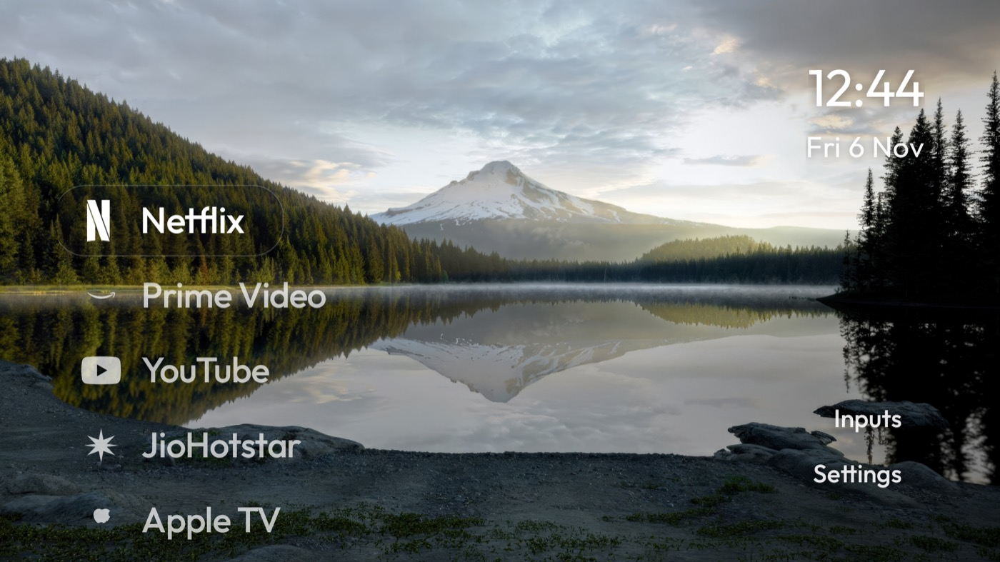

# TV Lobotomy

A quiet home screen for Android TV: your apps in one column, the time in the corner, and nothing
else. Built on [CleanYourTV](https://github.com/Gathin23/cleanyourtv), styled after
[CleanFrame](https://github.com/nthnclrk/CleanFrame).



*Running on the TV this was built for: `Toshiba_TV_with_MIC` / `songshan`, Android TV 11.*

## What it does

The stock Google TV home is a billboard: sponsored rows, a "Discover" shelf, recommendations you
never asked for. This replaces it with a single list.

- **One list, no rows.** Netflix, Prime Video, YouTube, JioHotstar, Apple TV — down the left side,
  large enough to read from the couch.
- **Monochrome icons, transparent tiles.** White vector glyphs instead of saturated banner cards,
  with the app name underneath and a soft glass highlight that springs to whatever is focused.
- **The clock and date, top right.** Nothing else competes for the wallpaper.
- **Three quiet buttons, bottom right.** Inputs, All apps, Settings.
- **Themes without a rebuild.** `themes/cleanframe/config.json` sets the layout, dock order and
  hidden apps; push it over ADB and Home restarts.
- **No network, no background services.** A native Java app, ~350 KB installed, built for 1 GB TVs.

The list layout is a fork addition on top of CleanYourTV 2.3: `layout: "list"`, `cleanframe_dock`
and `ambient_glow` become launcher options, plus a new `ListScrimView` for the corner vignettes and
twelve monochrome app icons. The rest of the tree — the debloat lists, recovery tools, docs and 80
example TVs — is upstream and unmodified apart from the notes below.

## What's in here

| Path | What it is |
| --- | --- |
| `launcher/` | The Android TV launcher (`com.gathin.tvhome`), plain Java, JDK 17, Android SDK 34 |
| `themes/cleanframe/` | The list layout theme. No wallpaper included — bring your own |
| `tools/` | ADB-over-TCP client, theme push, restore, wallpaper helper (Python 3.10+) |
| `examples/toshiba-tv-songshan/` | Notes and scripts for this exact TV: debloat list, build, restore |
| `tests/`, `.github/` | Python checks and CI, inherited from upstream |
| `UPSTREAM-README.md` | CleanYourTV's own README: TV tables, safety notes, troubleshooting |

## Verified on

| | |
| --- | --- |
| TV | Toshiba TV with MIC (`Toshiba_TV_with_MIC`), board `songshan`, Hisense/MediaTek, India |
| OS | Android TV 11 (API 30), build `RTT2.220118.001` |
| Stock launcher | `com.google.android.apps.tv.launcherx` (Google TV) |
| Launcher | `com.gathin.tvhome`, version 2.3 (versionCode 4), debug-signed, sideloaded |
| Theme | `themes/cleanframe/config.json`, `layout: "list"` |

Other Android TV / Google TV sets should work — the upstream project supports hundreds — but they
are untested with the list layout. **Fire TV and Samsung/LG are out:** Fire OS will not hand Home to
a third-party launcher, and Tizen/webOS are different systems entirely.

## Before you start

> **This replaces your TV's home screen.** Nothing is rooted, flashed or uninstalled, but if the
> install half-finishes you can end up with a TV whose Home does not open. Read this section, keep
> ADB on until you are happy, and know how to get back (see [Restore](#restore)).
>
> It also needs **wireless debugging left on** while you work, which means anyone on your Wi-Fi who
> has authorised keys can run shell commands on the TV. Turn it off when you're done.

You need:

- A computer on the same network as the TV (macOS, Linux or Windows).
- **JDK 17** and **Android SDK platform 34 + build-tools 34.0.0**.
  - macOS: `brew install openjdk@17 android-commandlinetools && sdkmanager "platforms;android-34" "build-tools;34.0.0"`
  - Linux: `~/Android/Sdk` with the same packages, or set `ANDROID_HOME`.
- **Python 3.10+** for the ADB tooling (no `adb` binary required).
- The TV's IP address: Settings → Network, or look for it in `arp -a`.

The commands below are macOS/Linux shell. On Windows, every script has a PowerShell twin
(`launcher\build-and-install.ps1`, `tools\disable.ps1`, …) — see
[`UPSTREAM-README.md`](UPSTREAM-README.md).

## Install

### 1. Turn on debugging on the TV

Settings → Device Preferences → About → press OK on **Build** seven times → back → **Developer
options** → **USB debugging** on. If there is a **Network debugging** / **ADB debugging** toggle,
turn that on too. Keep the TV awake.

### 2. Prepare the tools

```bash
git clone https://github.com/yugjain/tv-lobotomy.git
cd tv-lobotomy
python3 -m venv tools/venv
tools/venv/bin/pip install -r tools/requirements.txt
```

### 3. Check the connection

```bash
TV_HOST=192.168.1.50 tools/venv/bin/python tools/tv.py --probe
```

Accept **"Allow USB debugging?"** on the TV when it appears. You should get the model and Android
version back. If it hangs, see [Troubleshooting](#troubleshooting).

### 4. Build and install

```bash
TV_HOST=192.168.1.50 ./launcher/build-and-install.sh
```

That builds the release APK, pushes it, starts it, checks that it actually came up, then disables the
stock launcher and makes this one Home. It asks the TV which launcher owns Home first, and rolls the
stock one back if anything fails. `STOCK_LAUNCHER=none` leaves the stock launcher untouched.

### 5. Apply the list layout

```bash
TV_HOST=192.168.1.50 ./tools/theme.sh themes/cleanframe
```

Home restarts with the list, the monochrome icons and the cleanframe dock. Undo with
`./tools/theme.sh --reset`.

## Wallpaper

No wallpaper ships with this repo, on purpose — the ones in CleanFrame are third-party photographs.
Add your own 1920×1080 image:

```bash
TV_HOST=192.168.1.50 ./tools/set_wallpaper.sh ~/Pictures/valley.jpg
```

That crops it, writes `themes/cleanframe/wallpaper.jpg`, and pushes the theme. Or drop a
`wallpaper.jpg` into `themes/cleanframe/` and run `./tools/theme.sh themes/cleanframe`.

> `theme.sh` **removes the TV's wallpaper** when the theme folder has none, so run the wallpaper step
> or copy an image in first if you want one.

Set `"wallpaper": false` in the theme's `config.json` for a flat background instead, and change the
colour with `"background_color": "#070A14"`.

## Changing the list

Everything is in `themes/cleanframe/config.json`; push it again after editing — no rebuild:

```json
{
  "layout": "list",
  "cleanframe_dock": true,
  "dock_apps": [
    "com.netflix.ninja",
    "com.amazon.amazonvideo.livingroom",
    "com.google.android.youtube.tv",
    "in.startv.hotstar",
    "com.apple.atve.androidtv.appletv"
  ],
  "wallpaper": true,
  "sky_intensity": 0,
  "ambient_glow": false
}
```

- `dock_apps` — the list, top to bottom. Use package names from
  `TV_HOST=… tools/venv/bin/python tools/tv.py 'pm list packages'`.
- `hidden_apps` — packages to keep out of All apps.
- `layout` — `"list"` for this screen, omit it for the upstream grid.
- `ambient_glow`, `sky_intensity`, `background_color`, `accent_color` — see
  [`themes/README.md`](themes/README.md) for the full key list.

Dock order, hidden apps and the default dock also live in
[`launcher/app/src/main/res/values/config.xml`](launcher/app/src/main/res/values/config.xml) if you'd
rather bake them into the APK.

## Debloat (optional)

The launcher is the visible half. The other half is disabling the manufacturer's telemetry, promo
rows and preloaded apps with `pm disable-user`, which is reversible. This TV's list is in
[`examples/toshiba-tv-songshan/debloat.txt`](examples/toshiba-tv-songshan/debloat.txt):

```bash
TV_HOST=192.168.1.50 ./tools/disable.sh examples/toshiba-tv-songshan/debloat.txt
```

**Read the list before running it**, and read
[`examples/toshiba-tv-songshan/README.md`](examples/toshiba-tv-songshan/README.md) first: it explains
what each group does and which packages to keep (Live TV, HDMI inputs, remote pairing, casting).
Lists for other TVs are in [`examples/`](examples/); if yours isn't there, copy the closest one and
check every package on your own TV.

## Restore

Two levels:

```bash
# Undo the debloat list, put the stock launcher back, restore Private DNS
TV_HOST=192.168.1.50 ./examples/toshiba-tv-songshan/restore_tv.sh
```

or, upstream's record-based restore, which replays exactly what was disabled:

```bash
TV_HOST=192.168.1.50 ./tools/restore.sh examples/toshiba-tv-songshan/debloat.txt com.google.android.apps.tv.launcherx
```

The launcher stays installed after either; remove it from Settings → Apps if you want it gone. If
Home ends up on nothing, `tools/tv.py 'pm enable --user 0 com.google.android.apps.tv.launcherx'` and
`cmd package set-home-activity --user 0 com.google.android.apps.tv.launcherx/.home.HomeActivity`
get you back. The TV's own Settings → Apps page can re-enable packages without any of this.

## Turn ADB off when you're done

1. Settings → Device Preferences → Developer options.
2. **USB debugging** off; **Network debugging** / **ADB debugging** off if present.
3. **Revoke USB debugging authorisations** → OK.
4. Reboot, then confirm from your computer: `nc -vz 192.168.1.50 5555` should be refused.

## Troubleshooting

- **`No route to host`, or the probe hangs** — macOS Local Network privacy can block ADB; allow your
  terminal in System Settings → Privacy & Security → Local Network. Check the TV is awake and on the
  same Wi-Fi (not a guest network), and that network debugging is on.
- **"Allow USB debugging?" never appears** — wake the TV, run the probe again, and check the TV
  isn't showing a different dialogue behind an app.
- **Home lands on a black screen or a factory app** — the stock launcher was disabled before the new
  one started. Re-enable it with the commands in [Restore](#restore); the install script orders this
  correctly, so use it rather than doing it by hand.
- **Icons are boxes, or the list is empty** — the dock package names don't match what's installed.
  Check them with `pm list packages`.

More, including the setup-wizard trap on Google TV and per-TV notes, is in
[`docs/TROUBLESHOOTING.md`](docs/TROUBLESHOOTING.md) and
[`UPSTREAM-README.md`](UPSTREAM-README.md). The design notes and what changed from upstream are in
[`docs/TV-LOBOTOMY.md`](docs/TV-LOBOTOMY.md).

## Credits and licence

- [CleanYourTV](https://github.com/Gathin23/cleanyourtv) by Gathin — the launcher, the tools, the
  debloat lists and most of this tree. MIT.
- [CleanFrame](https://github.com/nthnclrk/CleanFrame) by Nathan Clarke — the visual idea: one list,
  monochrome icons, a clock in the corner. CleanFrame is a web app for Samsung The Frame; none of its
  code is used here, only the design.
- Font and icon licences: [`launcher/FONT-LICENSE-OFL.txt`](launcher/FONT-LICENSE-OFL.txt) and
  upstream's notices.

MIT, see [`LICENSE`](LICENSE). Not affiliated with Google, Toshiba, Hisense, Netflix or any app named
above; all trademarks belong to their owners. Use at your own risk.
